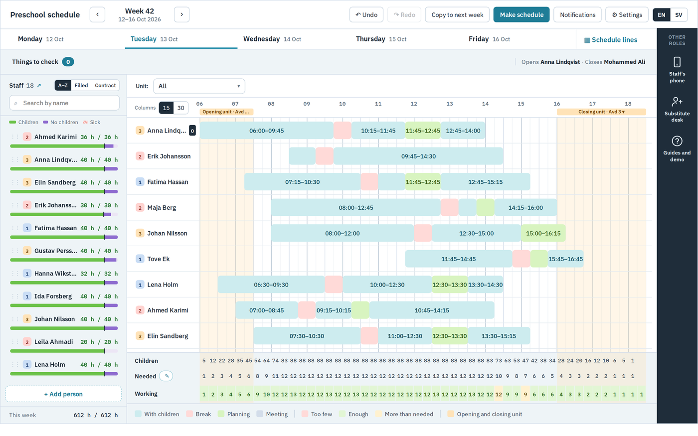
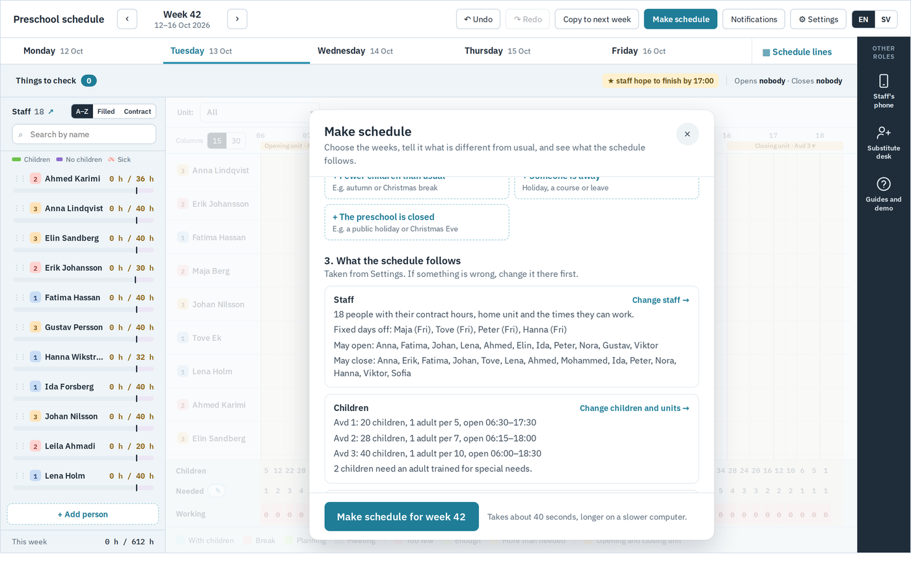
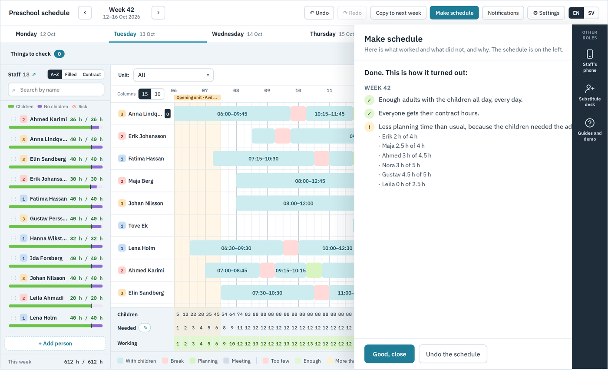
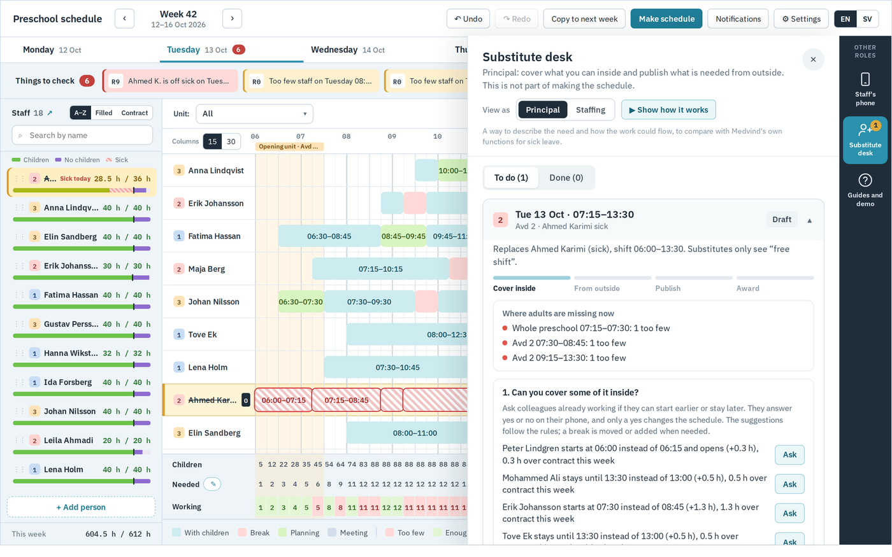
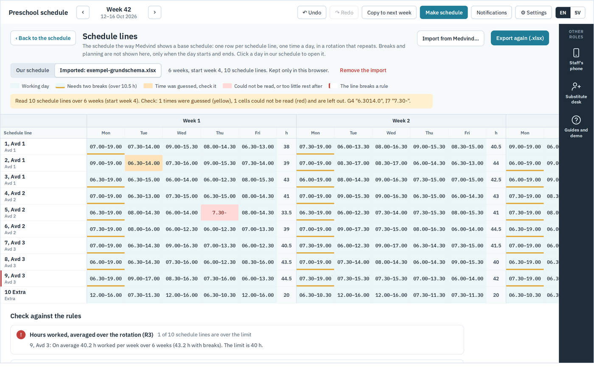
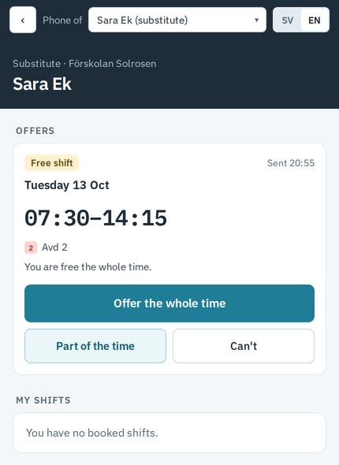

# Förskolans schema

A working prototype for staff scheduling in Swedish preschools (förskola): a planner for the person who makes the schedule, a phone app for staff and substitutes, a schedule solver built on Google OR-Tools, and a flow for covering sick leave.

The prototype was made in a pre-study with **Trollhättan Stad**, within the course *Project Work in AI and Automation* (PAI700) at **University West**, autumn 2026. All staff, units, children's numbers and substitutes in the demo are invented.

## What it does

- **Planner.** Each person's day with time with the children, breaks and planning, and under it the number of children, adults needed and adults working in every 15-minute slot. A rule check warns about rest, weekly hours, breaks, opening and closing, and special-needs cover.
- **Make schedule.** A form written for the scheduler, not a programmer: choose the weeks, say what is different from usual (a concert, an early closing, someone away, a closed day), and see which staff, children and rules the schedule follows. The solver (OR-Tools CP-SAT) then plans named staff under the Working Hours Act.
- **A plain-language report.** After solving, each week gets a short explanation of what worked, what did not, and why, so the result is not a black box.
- **Sick cover.** A sick report in the phone app turns the rest of the shift into a free shift. The principal first asks colleagues, then publishes to eligible substitutes; the staffing function awards the offers. Every change passes the same rule check, and substitutes never see who is sick or why.
- **Schedule lines and Medvind.** The schedule can be shown as a rotation of schedule lines, as in Medvind, and exported to or imported from Medvind's Excel format, with hand-typed times checked and flagged.
- **Children from Edlevo.** The number of children per unit can come from booked times in Edlevo, counted inside the municipality so that only counts, never child identities, reach the planner.

| Make schedule | Report | Substitute desk |
|---|---|---|
|  |  |  |

| Schedule lines | Phone app |
|---|---|
|  |  |

## Kom igång / Getting started

**Svenska**
1. Installera Python 3 en gång (gratis): https://www.python.org/downloads/. På Windows: kryssa i **"Add python.exe to PATH"** i installationen.
2. Hämta projektet: klicka **Code › Download ZIP** här på GitHub och packa upp filen (eller klona det med git).
3. Dubbelklicka på startfilen i mappen: **Start-Windows.bat** (Windows), **Start-Mac.command** (Mac; första gången högerklicka › Öppna) eller `./start.sh` (Linux).
4. Första gången installeras OR-Tools (en minut eller två, kräver internet). Sedan öppnas schemat i webbläsaren.
5. Låt fönstret som öppnades vara öppet medan du testar. Stäng det för att avsluta.

**English**
1. Install Python 3 once (free): https://www.python.org/downloads/. On Windows, tick **"Add python.exe to PATH"** in the installer.
2. Get the project: click **Code › Download ZIP** here on GitHub and unzip it (or clone it with git).
3. Double-click the start file: **Start-Windows.bat** (Windows), **Start-Mac.command** (Mac; the first time, right-click › Open) or `./start.sh` (Linux).
4. The first time, OR-Tools is installed (a minute or two, needs internet). Then the planner opens in the browser.
5. Keep the window that opened while you test. Close it to stop.

Everything runs on your own computer at http://localhost:8000/, and nothing is sent anywhere else. Data is kept in the browser; **Start over** under Settings › General resets it. To try the phone app on a real phone on the same Wi-Fi, start with `python3 start.py --lan` and open the address it prints.

Making one week takes roughly 40 seconds to two minutes, depending on the computer.

## Project structure

| Folder | What is in it |
|---|---|
| `web/` | The planner, settings and phone app (HTML and JavaScript). `schedule-core-demo.js` holds the data model, the rule check, the staffing need and the sick-cover logic. |
| `solver/` | The OR-Tools solver (`schedule_solver.py`) and a small local server (`server.py`). |
| `edlevo/` | Counting children per unit from Edlevo Calendar API responses (counts only). |
| `medvind/` | Reading and writing Medvind base schedules in Excel, and a rule-check report. |
| `tests/` | Tests for the shared logic, the solver scenarios, Medvind and Edlevo, and a browser walkthrough. |
| `bench/` | A benchmark of how long the solver takes on different computers. |
| `docs/` | Design, solver and sick-cover documentation. |

## Documentation

- [Design and domain model](docs/design.md) (Swedish summary of the scheduling part: [schemalaggning.sv.md](docs/schemalaggning.sv.md))
- [Schedule solver](docs/solver.md)
- [Sick cover](docs/sick-cover.md)
- [Edlevo counting](edlevo/README.md), [Medvind import and export](medvind/README.md), [Benchmark](bench/README.md)

## Tests

    node --test tests/core.test.mjs                                          # shared logic and rules (seconds)
    .venv/bin/python -m unittest tests/test_medvind.py tests/test_edlevo.py   # Medvind files and Edlevo counting (seconds)
    .venv/bin/python -m unittest tests/test_solver.py                        # eight solver scenarios, checked with the planner's rules (~10 min)
    BASE=http://localhost:8000 node tests/e2e.cjs                             # browser walkthrough; needs the demo running and Playwright

## Limitations

This is a proof of concept, not a finished system. It uses invented data, has no login, keeps its data in the browser, and is not connected to Edlevo or Medvind. Sending a case to the municipal substitute portal is only simulated, and pay and employment rules (extra hours, the collective agreement, booking hourly substitutes) are not modelled. The sick-cover flow is meant as a description of the needs, to compare with Medvind's own functions, not as a replacement for them.

## Use of AI

The prototype was developed with the help of an AI coding assistant (Claude, by Anthropic). The requirements, design decisions and testing come from the project and from the meetings with the municipality.

## Third-party software

[Google OR-Tools](https://developers.google.com/optimization) (Apache 2.0), React and Babel (MIT, included in `web/vendor/`), and the IBM Plex fonts (SIL Open Font License, included in `web/vendor/fonts/`).
